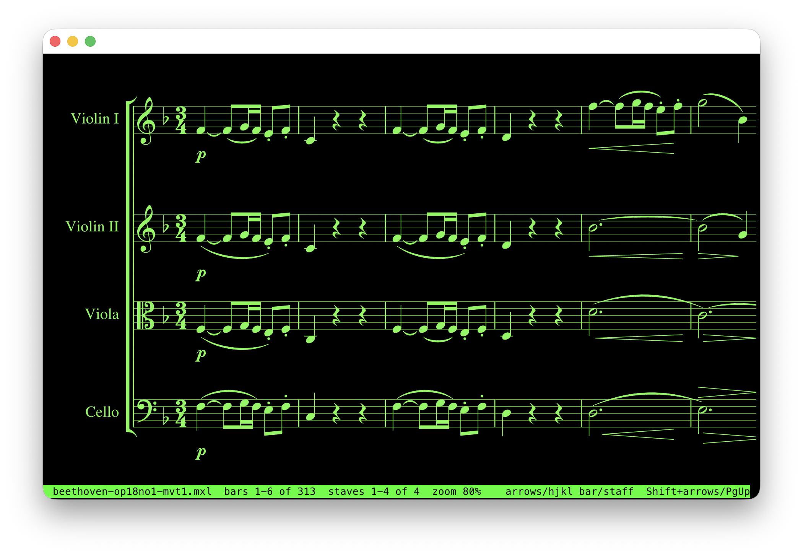

# stave

[](https://opensource.org/licenses/MIT)
[](https://en.cppreference.com/w/cpp/20)
[](https://cmake.org/)
[](https://git-scm.com/)

### **a music notation renderer on the CLI!**



*ascii and unicode is too coarse to render good musical notation, therefore it gets rendered to an svg using `Verovio` before getting rasterized with `lunasvg` onto the terminal via sixel. kitty is supported, but buggy so disabled for now. if your terminal has niether of these, braille is used as a fallback.*

It can also colour bars green, yellow and red to show what changed between two versions of a score,
which is how [motif](https://github.com/SamChenYu/motif) shows its diffs.

## Build

Requires CMake 3.20+ and a C++20 compiler (MSVC 2022, GCC 11+ or Clang 14+).

```
git submodule update --init
cmake -S . -B build
cmake --build build --config Release
```

## Run

Draws  pixels in terminals that can show sixel images (Windows Terminal 1.22+, WezTerm, foot,
iTerm2). Anywhere else it falls back to braille characters, 2x4 dots each (looks pretty bad tho). Kitty graphics
(kitty, Ghostty, WezTerm) also work but are never picked automatically for now, as it flickers. using`--kitty` forces them.

```
stave examples/beethoven-op18no1-mvt1.mxl   # a score full screen (MusicXML .musicxml/.xml/.mxl, MEI or ABC)
stave drawing.svg            # ...or an SVG
stave FILE --bar 9 --staff 2 # start somewhere else in a score (bars by their printed number)
stave FILE --added 40-60 --changed 12-15@2 --removed 7  # colour bars to show a diff
stave FILE --width 400       # start at another width
stave FILE --paper           # dark ink on a cream page, instead of the terminal's own colours
stave FILE --sixel           # force an output: --sixel, --kitty or --braille
stave FILE --print           # print it inline instead, like cat
stave FILE --png out.png     # save the first screen as a 1600x900 PNG
stave FILE --bench           # time loading, drawing and each output
stave --test-pattern         # a test image, to check that this terminal can show images
stave --terminal-info        # what stave found out about this terminal
```


## Controls for the terminal pager

| Key | In a score | In an SVG |
|---|---|---|
| ← → / h l | one bar | a tenth of the screen |
| ↑ ↓ / k j | one staff | a tenth of the screen |
| Shift+← → / H L | one screen sideways | one screen sideways |
| PgUp PgDn / Space | one screen up/down | one screen up/down |
| Home End / g G | first / last bar | start / end |
| + - | zoom | zoom |
| q / Esc / Ctrl+C | quit | quit |

The example scores in `examples/` are public-domain pieces; see `examples/README.md`.

## Showing a diff

`--added`, `--changed` and `--removed` colour bars green, yellow and red. this is how [motif](https://github.com/SamChenYu/motif) shows what changed between two versions of a score.

```
stave new.musicxml --added 40-60 --changed 12-15@2,20@3 --removed 7
```

| Value | Marks |
|---|---|
| `7` | bar 7 |
| `12-15` | bars 12 to 15 |
| `12-15@2` | bars 12 to 15, only on staff 2 |
| `3,7-9@1,20` | any mix of those |

bars go by their printed numbers, so a pickup is usually bar 0. staves count from the top, starting at 1.

## Tests

```
ctest --test-dir build -C Release --output-on-failure
```

## Dependencies

| Library | Version | Used for | 
|---|---|---|
| [lunasvg](https://github.com/sammycage/lunasvg) | 3.5.0 | rendering SVG to pixels |
| [Verovio](https://github.com/rism-digital/verovio) | 6.4.0 | music notation rendering |
| [doctest](https://github.com/doctest/doctest) | 2.5.3 | unit tests |

